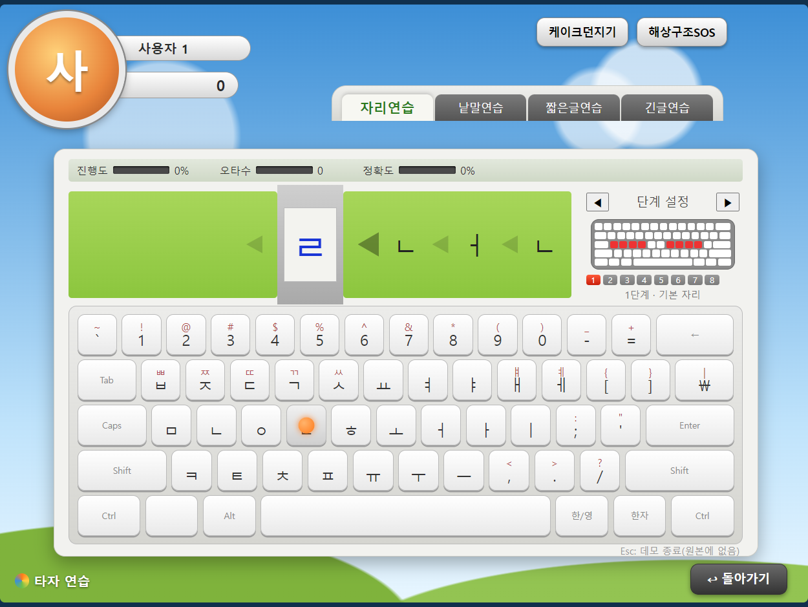
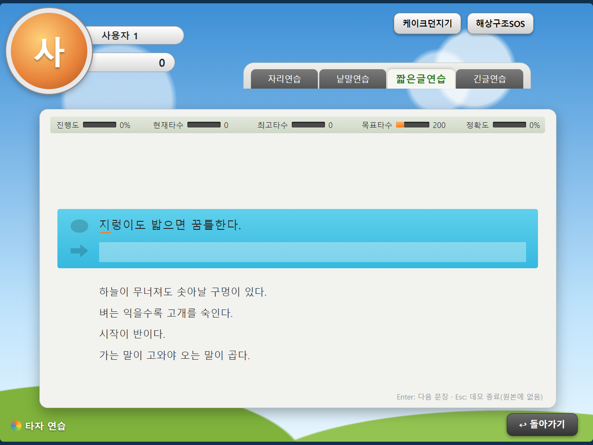

# 타자연습 (REA 재구현)

한컴타자연습 8.0(Windows)을 역공학 도구로 정적 분석하고, 그 결과를 바탕으로 같은 기능을 HTML/CSS/JS로 다시 만든 타자 연습 앱입니다.
브라우저에서 바로 실행할 수 있고, Electron으로 감싼 Windows 실행 파일(exe)로도 만들 수 있습니다.

- 원본 프로그램은 실행하지 않고, 설치 폴더의 실행 파일만 정적으로 분석했습니다.
- 타수 계산(두벌식 키 입력 단위), 정확도, 짧은글 32문장 규칙, 기록 저장 조건처럼 분석으로 확인한 규칙은 그대로 따랐습니다.
  - 코드 주석에서 분석으로 확인한 부분은 `[확인]`, 추정한 부분은 `[추정]`으로 구분했습니다.
- 원본의 캐릭터·로고·이미지·음원·연습 문장은 쓰지 않았습니다.
  - 화면은 도형과 그라데이션으로 그렸습니다.
  - 연습 문장은 일반 낱말, 속담·격언, 직접 지은 문단입니다.
- 원본에 없는 기능으로, 연습 중 Esc를 누르면 바로 결과 창을 보여 주는 데모 종료를 넣었습니다.

| 시작 화면 | 자리연습 |
|---|---|
|  |  |
| 짧은글연습 | 결과 창 |
|  |  |

나머지 화면 캡처는 [screenshots/app/](screenshots/app/)에 있습니다. 결과 창 캡처의 수치는 화면 예시용 샘플 값입니다.

## 폴더 구성

```
app/               HTML/CSS/JS 웹앱 (브라우저에서 바로 실행 가능)
  js/core/         한글 분해·타수 계산·저장·키보드·입력 처리
  js/screens/      화면별 코드 (시작, 자리, 낱말, 짧은글, 긴글, 결과, 설정/통계)
  js/data/         자체 연습 문장
desktop/           Electron 래퍼 (main.js, package.json) → desktop/dist 에 exe 생성
analysis/          분석·구현 문서
  HncTT80_analysis.md       원본 분석 결과 (관찰 / 추론 / 미확인 구분, Evidence ID 포함)
  implementation_notes.md   분석 결과를 어떻게 구현에 옮겼는지
  feature_table.md          원본 기능 대비 구현 여부(O/△/X) 비교표
screenshots/app/   이 앱의 화면 캡처
```

## 사용한 도구

| 도구 | 용도 |
|---|---|
| [REA](https://github.com/morluto/rea) (rea-agents MCP 서버) | 역공학 도구를 AI 에이전트에서 쓰게 해 주는 MCP 서버. 문자열·함수·교차참조 검색, 의사코드, PE 리소스 분석에 사용 |
| [Ghidra](https://ghidra-sre.org/) 12.1.4 | REA가 쓰는 디스어셈블러·디컴파일러 엔진. 메인 exe의 함수 의사코드와 RTTI 클래스 정보 추출 |
| [Claude Code](https://claude.com/claude-code) | REA를 호출해 분석을 진행하고, 분석 문서 작성, 웹앱·Electron 래퍼 구현, 브라우저 검증까지 수행 |
| Electron 33 / electron-builder 25 | 웹앱을 Windows portable exe로 패키징 |

분석 과정과 근거(함수 주소, 리소스 문자열 ID, Evidence ID)는 [analysis/HncTT80_analysis.md](analysis/HncTT80_analysis.md)에 정리되어 있습니다.

## 주의

- 이 저장소는 학습·연구 목적의 재구현입니다. 한컴타자연습의 상표와 원본 리소스는 한글과컴퓨터에 있습니다.
- 원본 프로그램의 실행 파일, 데이터 파일, 화면 캡처는 저장소에 포함하지 않습니다.

## 웹앱으로 실행

- `app/index.html`을 더블클릭해서 브라우저로 엽니다.
- 또는 로컬 서버로 엽니다. 실행 후 http://localhost:8765 에 접속합니다.

```bash
python -m http.server 8765 --directory app
```

## 데스크톱 앱(exe) 실행

`desktop/dist/TypingTrainer-REA-1.0.0-portable.exe`를 더블클릭합니다. 설치 과정이 없습니다.

- 창 크기는 1000×750(내용 영역)으로 고정이고, 크기 조절·최대화가 막혀 있습니다.
- 메뉴바가 없고, 창 제목은 "타자연습 (REA 재구현)"입니다.
- 사용자·설정·기록은 `%APPDATA%\rea-typing-trainer` 아래에 localStorage로 저장되어, exe를 다시 실행하거나 다른 폴더로 옮겨도 유지됩니다.
  - 기록을 지우려면 앱을 끄고 이 폴더를 삭제하면 됩니다.
- 서명하지 않은 exe라서 처음 실행할 때 Windows SmartScreen 경고가 뜰 수 있습니다. "추가 정보 → 실행"을 누르면 됩니다.
- portable exe는 실행할 때마다 임시 폴더에 풀리므로 첫 화면이 뜨기까지 몇 초 걸릴 수 있습니다.

## exe 빌드 방법

필요한 것: Node.js 18 이상, npm, 인터넷 연결(첫 빌드 때 Electron과 빌드 도구를 내려받음)

```bash
cd desktop
```

```bash
npm install
```

```bash
npm start
```

`npm start`는 빌드 없이 Electron 창으로 바로 실행해 확인하는 명령입니다. 이때는 저장소의 `app/` 폴더를 직접 읽습니다.

```bash
npm run dist
```

결과물은 `desktop/dist/TypingTrainer-REA-<버전>-portable.exe`입니다. `desktop/dist/win-unpacked/`는 압축하기 전의 중간 결과물이라 배포에는 필요 없습니다.

### 빌드가 "Cannot create symbolic link" 오류로 실패할 때

electron-builder가 내려받는 `winCodeSign` 압축 파일 안에 macOS용 심볼릭 링크가 있어서, Windows에서 관리자 권한이나 개발자 모드가 없으면 압축 해제가 실패합니다. 다음 중 하나로 해결합니다.

1. Windows 설정 → 시스템 → 개발자용 → **개발자 모드**를 켜고 다시 빌드합니다.
2. 또는 macOS용 폴더만 빼고 캐시에 직접 풀어 둡니다 (PowerShell, `desktop` 폴더에서 실행).

```powershell
$c = "$env:LOCALAPPDATA\electron-builder\Cache\winCodeSign"; $z = Get-ChildItem $c -Filter *.7z | Select-Object -First 1; & .\node_modules\7zip-bin\win\x64\7za.exe x -bd $z.FullName "-o$c\winCodeSign-2.6.0" "-xr!darwin"
```

그다음 `npm run dist`를 다시 실행합니다.

### 빌드가 "EBUSY: resource busy or locked" 오류로 실패할 때

이전 빌드가 실패하면서 남은 `desktop/dist` 폴더를 지우고 다시 빌드합니다. 실행 중인 exe가 있으면 먼저 종료합니다.

## 구조 메모

- `app/`의 파일은 수정하지 않았습니다. 빌드할 때 electron-builder `extraResources`로 exe 안의 `resources/app`에 복사됩니다.
- `desktop/main.js`는 웹앱을 `file://` 대신 고정 주소 `app://typing/`으로 띄웁니다.
  - portable exe는 실행할 때마다 다른 임시 경로에 풀리므로, 저장소 출처(origin)를 고정해 localStorage가 항상 같은 곳을 쓰도록 하기 위함입니다.
- 같은 exe를 두 번 실행하면 이미 열린 창이 앞으로 나옵니다. 두 창이 같은 기록을 동시에 덮어쓰지 않게 하려는 것입니다.
- 원본 기능과의 비교는 [analysis/feature_table.md](analysis/feature_table.md), 구현 근거는 [analysis/implementation_notes.md](analysis/implementation_notes.md)를 보세요.
